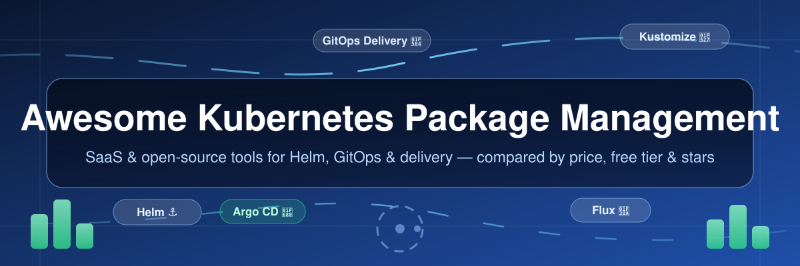

# 🐳 Awesome Kubernetes Package Management — Helm, GitOps & Kubernetes Deployment Tools

  

<table><tr><td align="left"></td><td align="right"></td></tr></table>

<!--
  SEO keywords: kubernetes package manager, kubernetes package management tools, helm charts, helm alternatives, helm vs kustomize, gitops tools, argo cd, flux cd, kubernetes deployment tools, kubernetes CI/CD, OCI registry, yaml templating, kubernetes SaaS pricing, awesome list 2026
  Description: The largest curated Kubernetes packaging & GitOps list — 27+ open-source repositories with live GitHub star badges, plus 8 SaaS platforms compared on starting price, free-tier limits and company size.
  Canonical: github.com/ishandutta2007/Awesome-Kubernetes-Package-Management
-->

## ⚓ Top Kubernetes Package Management Ecosystem

**The curated list of Kubernetes package management tools: SaaS platforms & open-source GitHub projects, compared**  

*Application packaging, Helm chart templating, OCI registry artifacts, YAML overlays & GitOps delivery*  

🗓️ **Last updated: October 2026**

The best **Kubernetes package management** tools in one place — notable **SaaS platforms** and **open-source projects** that template, package, distribute, and deploy applications to Kubernetes. Use it to compare **Helm vs Kustomize**, CUE-powered Helm alternatives such as Timoni, YAML-overlay tools, and GitOps-native delivery frameworks like Argo CD and Flux — with pricing, free-tier limits and GitHub stars side by side.

**Examples** include Helm, Kustomize, Argo CD, Flux, Carvel, Timoni, Glasskube, Devtron, and Skaffold (the category leaders).

🔓 **Open-source emphasis**: This section is heavily expanded with every major active project for self-hosting, GitOps-native delivery, and transparent package management — ideal for platform engineers, DevOps teams, and organizations building vendor-neutral Kubernetes delivery pipelines.

Contributions welcome! Open an PR to add/update entries. Keep descriptions factual and link to official sites.

## 📑 Table of Contents

- 💼 [SaaS/Hosted Platforms](#saas-hosted-platforms)

  - 📊 [Sector Overview & Market Dynamics](#sector-overview--market-dynamics)

- 🌟 [Open-Source GitHub Projects](#open-source-github-projects)

- ❓ [Frequently Asked Questions](#frequently-asked-questions)

- 🤝 [How to Contribute](#how-to-contribute)

- ⚠️ [Disclaimer](#disclaimer)

## 💼 SaaS/Hosted Platforms

### 📊 Sector Overview & Market Dynamics

📦 **Sector:** Kubernetes packaging, templating & GitOps delivery.

💰 **Estimated market size:** the underlying Kubernetes market is **~$2.57B in 2025**, forecast **$8.41B by 2031** (Mordor Intelligence); the GitOps segment alone is **~$1.86B in 2025**, heading to **$8.48B by 2034** (TrendX Insights), while the adjacent CI/CD tooling market — into which these packages feed — is **~$13.2B in 2026**, forecast **$22.9B by 2033** (Persistence Market Research). These are overlapping estimates, not additive.

🧭 **Market structure: moderately fragmented — not winner-take-all.** Several strong vendors co-exist and are commonly mixed inside one organisation (Helm for third-party charts, Kustomize for first-party manifests, Argo CD *and* Flux for GitOps), and CI adoption is spread across GitHub Actions (33%), Jenkins (28%) and GitLab CI (19%) rather than collapsing onto a single platform. Helm is the de-facto standard *inside* the packaging niche, but no single vendor captures the whole delivery stack.

| # | 🛍 Product | 🏢 Company Size (latest disclosed revenue / valuation / funding) | 📝 Description | 💲 Pricing (starting tier) | 🆓 Free Tier / Free Trial Limits |
|---|---------|---------------------------------------------------------------|-------------|--------------------------|-------------------------------|
| 1 | **[Harbor](https://goharbor.io/)** (managed third-party: [Stellar Hosted](https://www.stellarhosted.com/harbor/)) | Stewarded by the **CNCF**; originated at VMware — parent **Broadcom: $63.9B revenue (FY2025)** | Open-source cloud native registry with Helm chart repository support and OCI artifact management. | **No official Harbor SaaS.** Self-hosted: **$0 licence** (Apache-2.0, you pay infra). Closest managed option: Stellar Hosted **Standard €49/month** (1 vCPU, 2 GB RAM, 25 GB storage), Premium €99/month. | **Free forever:** self-hosted Harbor (CNCF Graduated) with **no user, repo or project caps**. Managed hosting offers a **14-day free trial** (no payment details, no user limit, quotas per plan hardware above). |
| 2 | **[Argo CD](https://argo-cd.readthedocs.io/)** (managed: [Akuity](https://akuity.io/pricing)) | Creator **Intuit: $18.83B revenue (FY2025)**; Akuity (managed) raised **$25M** | Declarative GitOps continuous delivery for Kubernetes — the de facto GitOps standard, with a rich UI and multi-cluster support. | **Akuity Pro: $495/month** (1 Argo CD instance, 50 apps, unlimited clusters & users; extra pack of 10 apps + 10 stages = $99/month). Self-hosted Argo CD: **$0** (Apache-2.0). | **30-day free trial** of Akuity Pro (ToS allows 14+ days; quota: 1 instance, 50 apps, 50 stages — no credit card). **Free forever:** self-hosted Argo CD with **no cap** on clusters/apps/users. |
| 3 | **[JFrog Artifactory](https://jfrog.com/artifactory/)** (vendor: [JFrog Ltd.](https://jfrog.com/pricing/)) | **JFrog Ltd. (NASDAQ: FROG): $531.8M revenue (FY2025)**, ~$10.4B market cap | Universal artifact repository manager supporting Helm chart repositories and OCI registries for Kubernetes package distribution. | **JFrog Cloud Pro: $50/month for the first year** ($150/month standard, 25 GB included); **Enterprise X: from $950/month** (125 GB); Enterprise+: custom. | **14-day free trial** of JFrog Cloud (no credit card; Pro quota 25 GB base, billed usage extra). **Free forever:** self-managed **Artifactory OSS** (Apache-2.0) — $0 licence, no storage/egress quota (you size the hardware; HA, replication & advanced security are Pro-only). |
| 4 | **[Octopus Deploy](https://octopus.com/pricing/overview)** | **$79.8M ARR (Q2 2025)**; valued ~**A$883M**; **$202.5M raised** (Insight Partners) | Deployment automation platform with Kubernetes support for managing releases across environments. | **Professional: $104/project/year**; **Enterprise: $156/project/year**; tenants & machines $77 each/year. Octopus Cloud platform fee from **$2,250/year** (5 tasks); Pro bundle **$4,330/year for 20 projects**. | **Free forever (no time limit):** **10 projects, 10 tenants, 10 machines, 10 users** with full RBAC + SSO (Cloud free instances need 1 deployment/runbook every 60 days). **30-day trial** of full Enterprise features. |
| 5 | **[Cloudsmith](https://cloudsmith.io/pricing)** | **$124M venture funding** (Series C, 2026); revenue undisclosed | Universal package management with OCI/Docker registry support for hosting Helm charts and Kubernetes artifacts. | **Core: $0/month**; **Pro: $149/month**; Ultra & Enterprise: custom-quoted (not publicly listed). | **Core — free forever:** public package hosting at $0; **OSS-eligible repos get 50 GB artifact storage + 200 GB package delivery free** (attribution required). |
| 6 | **[Flux CD](https://fluxcd.io/)** (commercial support: [ControlPlane](https://fluxcd.control-plane.io/pricing/)) | Creator **Weaveworks: $61M+ raised**; operations ceased Feb 2024 — Flux is now backed by the CNCF community | GitOps toolkit from the CNCF with a modular controller-based architecture; the original GitOps operator and direct competitor to Argo CD. | **No official SaaS.** ControlPlane Enterprise for Flux starts at **$1,250/month billed annually** (up to 1 production cluster / 10 nodes; next tier $6,250/month, then $10,500/month). | **Free forever:** self-hosted Flux (Apache-2.0, CNCF Graduated) — unlimited clusters/repos, community best-effort support; dev & staging clusters included free on paid plans too. |
| 7 | **[Devtron](https://devtron.ai/pricing)** | **$12M Series A (2022, Insight Partners)**; revenue undisclosed | Open-source Kubernetes delivery platform with a GUI for Helm-based app management, CI/CD, and security scanning. | **Starter: $999/month** (up to 500 vCPUs, 50 users, 5 clusters); **Growth: $2,000/month** (1,500 vCPUs, 75 users, 10 clusters); OSS Plus $499/month; Enterprise Plus custom. | **Freemium — free forever:** up to **50 vCPUs, 10 users, 1 cluster**, no credit card required. SaaS-managed plan adds a **30-day trial**. |
| 8 | **[Glasskube Cloud](https://glasskube.dev/cloud)** | **YC Summer 2024** — early-stage startup; funding not disclosed (YC standard deal $500K) | Managed offering for Glasskube with private packages, security alerts, and advanced GitOps integrations (in development). | **No paid tier published yet** — Cloud is in public preview; self-hosted Glasskube is **$0** (Apache-2.0). | **Free during the public beta** — non-production clusters only (cloud quota limits not yet published). **Free forever:** self-hosted OSS package manager — unlimited packages/clusters, community support. |

## 🌟 Open-Source GitHub Projects

*Sorted by GitHub star count ⭐ (descending). Every entry carries a live star badge that links straight to that repository's stargazers page — counts refreshed automatically by shields.io.*

-  **[Helm](https://github.com/helm/helm)**  

  **The de facto Kubernetes package manager** — CNCF Graduated, the category leader (30,000+ stars). Uses Go templates and `values.yaml` to generate Kubernetes manifests from reusable "charts." Supports chart repositories (HTTP/OCI), release tracking, rollbacks, hooks, and dependency management. The standard for installing third-party software like Prometheus, NGINX Ingress, and cert-manager.

-  **[Argo CD](https://github.com/argoproj/argo-cd)**  

  **GitOps continuous delivery** — CNCF Graduated, the dominant GitOps tool. Declarative, Git-based deployment with auto-sync, drift detection, multi-cluster management, and a rich UI.

-  **[Skaffold](https://github.com/GoogleContainerTools/skaffold)**  

  **Continuous development for Kubernetes** — handles building, pushing, and deploying applications with a single `skaffold dev` command. Supports Helm, Kustomize, and raw YAML as deployment renderers. Excellent for local development inner-loop.

-  **[Kustomize](https://github.com/kubernetes-sigs/kustomize)**  

  **Template-free configuration customization** — built into `kubectl` since v1.14. Uses `kustomization.yaml` overlays to patch base YAML without modifying originals. No templating language to learn; ideal for environment promotion (base → dev → staging → production). Native GitOps integration.

-  **[Crossplane](https://github.com/crossplane/crossplane)**  

  **Declarative infrastructure provisioning as Kubernetes resources** — exposes clouds and services as Kubernetes APIs, so platform teams can package and version infrastructure alongside application packages. Complements package management for full platform automation.

-  **[Kompose](https://github.com/kubernetes/kompose)* ✨ new *Docker Compose → Kubernetes converter** — translates `docker-compose.yaml` straight into Kubernetes manifests and services (`kompose convert`, `kompose up`): the fastest packaging on-ramp for teams migrating legacy Compose stacks.

-  **[Bitnami Charts](https://github.com/bitnami/charts)* ✨ new *The most used public Helm chart catalog** — thousands of production-ready, continuously rebuilt charts for databases, middleware and infrastructure (Bitnami, part of Broadcom), consumable over HTTP or OCI.

-  **[Tilt](https://github.com/tilt-dev/tilt)**  

  **Local development environment for Kubernetes** — smart rebuilds, live updates, and a UI showing service health. Accelerates inner-loop development for microservices.

-  **[Flux CD](https://github.com/fluxcd/flux2)**  

  **GitOps toolkit** — CNCF Graduated, modular controller-based architecture. Supports Helm Controller, Kustomize Controller, and source controllers for Git/OCI/Helm repositories.

-  **[KubeVela](https://github.com/kubevela/kubevela)* ✨ new *Application delivery platform built on the Open Application Model (OAM)** — packages repeatable application definitions and deploy-time policies as reusable components, so the same app package runs the same way on every cluster.

-  **[Krew](https://github.com/kubernetes-sigs/krew)* ✨ new *Homebrew for `kubectl`** — the package manager for kubectl plugins: discover, install and upgrade cross-platform command extensions from a searchable index of 100+ plugins.

-  **[Kubeapps](https://github.com/vmware-tanzu/kubeapps)**  

  **Web-based UI for deploying and managing Helm charts and Carvel packages** in Kubernetes clusters. Browse catalogs, deploy with custom values, and manage releases.

-  **[Garden](https://github.com/garden-io/garden)**  

  **Automation for Kubernetes development and testing** — uses a declarative config to define stacks, with smart caching and dependency-aware builds.

-  **[Glasskube](https://github.com/glasskube/glasskube)**  

  **Homebrew/npm-style package manager for Kubernetes** — YC-backed, aims to make deploying, updating, and configuring packages 20x faster than Helm. Type-safe package configurations via UI or interactive CLI, safe package updates pre-tested by Glasskube, GitOps integration (all packages are custom resources), and dependency management. Apache 2.0 licensed.

-  **[ORAS](https://github.com/oras-project/oras)* ✨ new *OCI Registry As Storage** — CLI and Go libraries for storing non-container artifacts (Helm charts, SBOMs, signatures, config) in any OCI registry. The reference client behind the "push charts as OCI artifacts" pattern.

-  **[Timoni](https://github.com/stefanprodan/timoni)**  

  **Helm alternative powered by CUE** — Apache 2.0. Uses CUE's type safety, code generation, and validation instead of Go templates mixed with YAML. Modules distributed as OCI artifacts (signable with Cosign), server-side apply, staged resource application, CRD templating and upgrades (which Helm ignores), and health checks on custom resources. Still in active development with potentially breaking API changes.

-  **[kpt](https://github.com/GoogleContainerTools/kpt)**  

  **Kubernetes package toolkit** — package, distribute, and apply versioned configuration bundles using KRM Functions for declarative customization, diffing and upstream updates.

-  **[Operator Lifecycle Manager (OLM)](https://github.com/operator-framework/operator-lifecycle-manager)* ✨ new *The package manager for Kubernetes Operators** — installs, versions, upgrades and resolves dependencies of Operators via CSVs and operator catalogs; the engine behind OperatorHub.io and OpenShift's Operatorhub.

-  **[Helm chart-testing (`ct`)](https://github.com/helm/chart-testing)* ✨ new *CI linter for Helm charts** — validates chart structure, linting (`helm lint`), YAML syntax and installs charts into a kind cluster; the de-facto gate for chart repositories in CI.

-  **[chart-releaser](https://github.com/helm/chart-releaser)* ✨ new *Publishes Helm charts as GitHub Releases and regenerates `index.yaml`** — the standard way to host a versioned chart repository on GitHub Pages.

-  **[Carvel (ytt, kapp, kbld, imgpkg)](https://github.com/carvel-dev/carvel)**  

  **The "Swiss Army Knife" of Kubernetes configuration** — a set of single-purpose, composable tools. `ytt` provides YAML-structure-aware templating with Starlark (Python-like) instead of text substitution; `kapp` deploys resources as a single application with change-set previews; `kbld` resolves images to immutable digests; `imgpkg` bundles config and images as OCI artifacts for air-gapped environments. Apache 2.0 licensed.

-  **[kapp-controller (Carvel)](https://github.com/carvel-dev/kapp-controller)**  

  **Continuous delivery and package management for Kubernetes** — captures application deployment workflows in an App CRD, enabling GitOps-style continuous delivery with Carvel tools.

-  **[OperatorHub / Community Operators](https://github.com/k8s-operatorhub/community-operators)**  

  The catalog behind [operatorhub.io](https://operatorhub.io/) — **hundreds of community-maintained Kubernetes Operators** packaged for installation and lifecycle management.

-  **[octoploy](https://github.com/davidgiga1993/octoploy)**  

  Simple templating engine with folder-based app definitions, variable inheritance, and configmap file watching — also on [PyPI](https://pypi.org/project/octoploy/).

-  **[app2kube](https://github.com/n0madic/app2kube)**  

  Generates production-ready manifests from a minimal app definition with safe-by-default hardening (security contexts, probes, resource baselines).

-  **[Sherpack](https://github.com/alegeay/sherpack)**  

  Helm-like package manager with Jinja2 templating, written in Rust. Features `lookup()` for reading cluster state, idempotent secret generation, and superior CRD management (templated CRDs, managed/shared/external policies).

-  **[frank-cli](https://github.com/schnauzersoft/frank-cli)**  

  Stateless, packageless, template-driven Kubernetes management with Jinja and HCL templating.

🧰 **Frameworks for building custom systems**: The **standard trio** is **Helm** for third-party packages (charts), **Kustomize** for your own applications (overlays), and **Argo CD** or **Flux** for GitOps delivery . For teams seeking alternatives to Go templates, **Carvel** provides YAML-structure-aware templating with Starlark, while **Timoni** leverages CUE for type-safe configuration. For a Homebrew-like experience, **Glasskube** offers type-safe package management with a UI.

💡 **Key architectural insight**: Helm remains the only widely-adopted tool for consuming packaged third-party software . Kustomize is built into `kubectl` and maps naturally to GitOps directory structures. Many teams use both: Helm to render third-party charts, Kustomize to patch them, then Argo CD or Flux to sync to the cluster. The lack of interoperability between configuration managers remains the main obstacle to adoption of alternatives .

## ❓ Frequently Asked Questions

**❓ What is Kubernetes package management?**  
Kubernetes package management covers packaging, versioning, templating and installing reversible collections of YAML — Helm charts, Kustomize overlays, Carvel bundles or OCI artifacts — so applications ship consistently across clusters.

**❓ Which is the best package manager for Kubernetes?**  
Helm is the de facto standard for third-party packages (30,000+ stars), Kustomize ships inside `kubectl` for first-party configuration, and Argo CD or Flux layer GitOps continuous delivery on top. Most platform teams run a deliberate combination of all three.

**❓ Helm vs Kustomize vs Argo CD / Flux — what is the difference?**  
Helm renders templates from `values.yaml`, Kustomize patches base YAML with overlays, and Argo CD or Flux continuously reconcile desired state from Git: Helm *installs* packages, Kustomize *customises* them, GitOps tools *deliver and keep* them running.

**❓ Are there free Kubernetes deployment tools?**  
Yes — Helm, Kustomize, Argo CD, Flux, Skaffold, Tilt, Kompose, Carvel, Timoni, Glasskube and ORAS are all free and open source. The [SaaS table](#saas-hosted-platforms) above lists the managed alternatives with exact starting prices and free-tier limits (for example Devtron's free-forever 50-vCPU plan and Octopus Deploy's free 10-project tier).

**❓ How do I add a Kubernetes tool to this list?**  
Open a PR — see [How to Contribute](#how-to-contribute).

## 🤝 How to Contribute

1. Fork the repo.

2. Add/edit entries in `README.md` (follow existing format).

3. Include: name, link, 1–2 sentence description, and whether it's SaaS or open-source.

4. Submit PR with a short explanation.

Star the repo if you find it useful!

## ⚠️ Disclaimer

- This is a **community-curated** list — not exhaustive and not an endorsement.

- **License awareness**: Helm, Kustomize, Carvel, and Timoni are Apache 2.0. Glasskube is Apache 2.0. Verify terms before commercial deployment.

- Self-hosted solutions require Kubernetes operational expertise, proper RBAC configuration, and regular security updates.

- Helm's Go template + YAML combination is powerful but can become complex; Kustomize's overlay approach is simpler but lacks dependency management and rollback features .

---

🛠️ **Made for platform engineers, DevOps teams, Kubernetes operators, and cloud-native enthusiasts.**  

Let's make Kubernetes package management more open, composable, and vendor-neutral.
